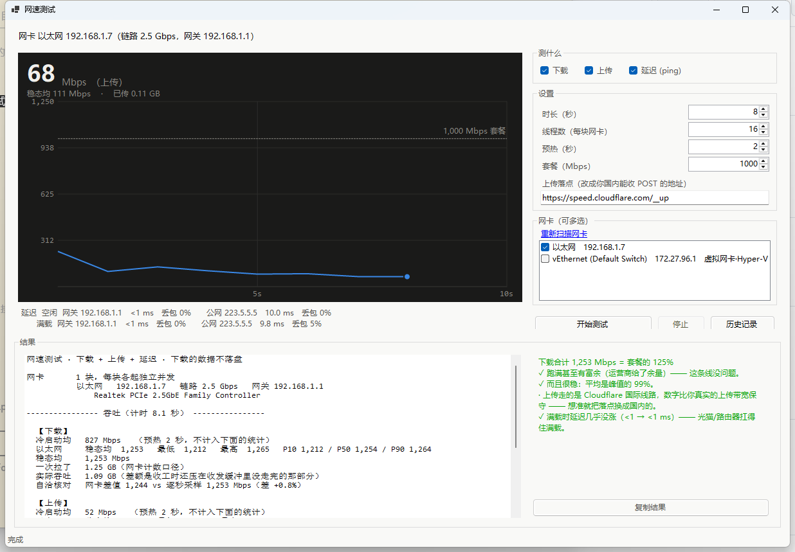

# 网速测试

一个 Windows 上的测速小工具：**下载 / 上传 / 延迟**三项任意勾选，实时曲线，多网卡同时测，本地历史记录。

单文件 exe，不需要安装，**不需要管理员权限**。



## 为什么不用现成的测速网站

测速网站只给你一个平均值，看不出"时高时低"。这个工具把**每秒的真实速率**直接画成曲线，抖不抖一眼就能看见。

它还会在**空闲**和**带宽拉满**两种状态下各测一遍延迟 —— 两者一比就知道你家的光猫/路由器会不会在满载时排队（bufferbloat）。这一条测速网站基本都不给。

## 功能

- **下载 / 上传 / 延迟，勾几项测几项**。一项一项依次跑，不是同时抢带宽（同时跑的话两个数都只有一半）
- **实时曲线**：一块网卡一条线，套餐值画成参考虚线，左上角是当前合计
- **多网卡同时测**：每块各起独立的并发，报告和曲线都分别给数据，再给合计
- **本地历史记录**：每跑一次自动存一条，能查列表、看报告原文、导出 CSV
- **上传落点可配置**：填进框里就生效，不用改代码
- 只测下载时，下载的数据**读进内存就扔掉，不落盘**
- 带命令行模式，可以塞进脚本

## 用法

双击 `网速测试.exe` 就能用。界面上「测什么」勾选项，「开始测试」开跑。

想自己编译：双击 `编译.bat`（需要 .NET 10 SDK，**零第三方依赖**，离线也能编）。

命令行模式：

```bat
网速测试.exe --cli --seconds 15 --threads 16 --out 报告.txt
网速测试.exe --cli --list-nics
网速测试.exe --cli --upload --upload-url https://你的地址/upload --no-download
```

完整参数和界面说明见 [说明.txt](说明.txt)。

## 是怎么算的

**吞吐** —— 多线程从 8 台国内镜像站同时拉 Ubuntu ISO（下载），或向落点 POST 数据（上传），
每秒钟读一次网卡计数器算瞬时速率。镜像轮转是为了避开单站限速。
正式计时前先预热几秒把连接建好，预热段不算进统计。

报告里有两个口径，别搞混：

| 名字 | 是什么 |
|---|---|
| 一次拉了 / 一次发出 | 网卡计数器口径，是这条线路**真实的吞吐** |
| 实际吞吐 | 程序真正读进来/写出去的字节数，天然比上面少一截 —— 收工那一刻还有数据压在收发缓冲里没走完 |

还有一行「自洽核对」，是拿网卡差值反推的速率和逐秒采样的平均对一下，差在 1% 内算正常。

**延迟** —— 走系统的 ICMP Echo，不需要管理员。空闲测一遍、满载再测一遍。

## 已知限制

- **上传落点**默认用 `speed.cloudflare.com/__up`。它会收下 body 直接丢弃，但**走国际线路，
  数字比你真实的上传带宽保守，而且波动大**。国内能公开收上传的测速点基本都关掉了
  （中科大的服务器返回 500，Ookla 的接口 403）。
  想测准，把「上传落点」换成你自己的地址即可 —— 要求：**收 POST、不鉴权、收下 body 直接丢弃**。
- **多网卡的合计不会超过同一条上游的总带宽**。几块网卡挂在同一个路由器上时，
  只是把同一条管子分成几股，不是真的翻倍。要看到翻倍得是两条独立的上游。
- 发布的是**依赖框架**的单文件 exe（约 270 KB），需要机器上装 .NET 10 桌面运行时。

## 许可

未指定许可证。
